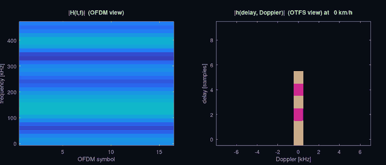
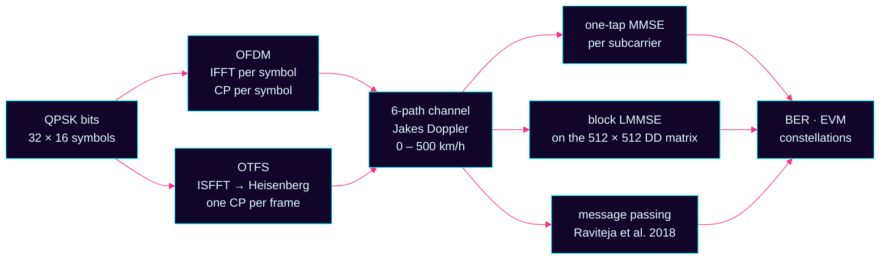
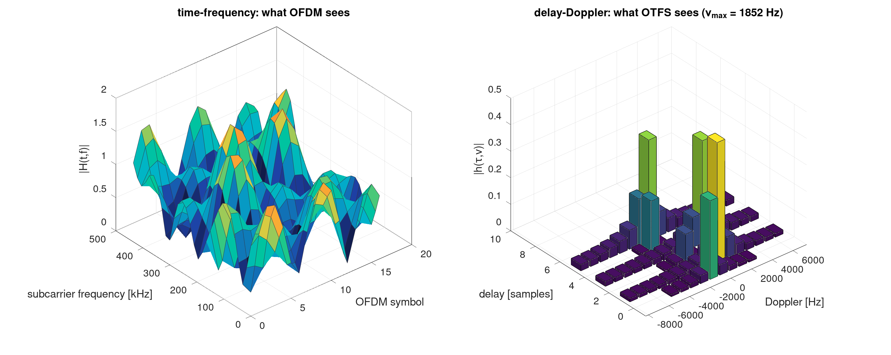
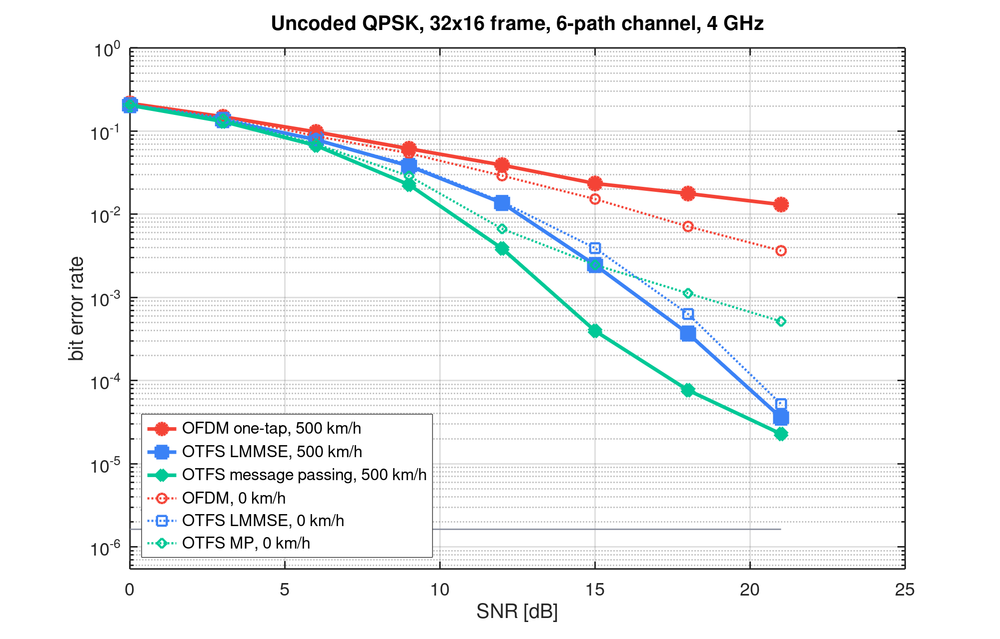
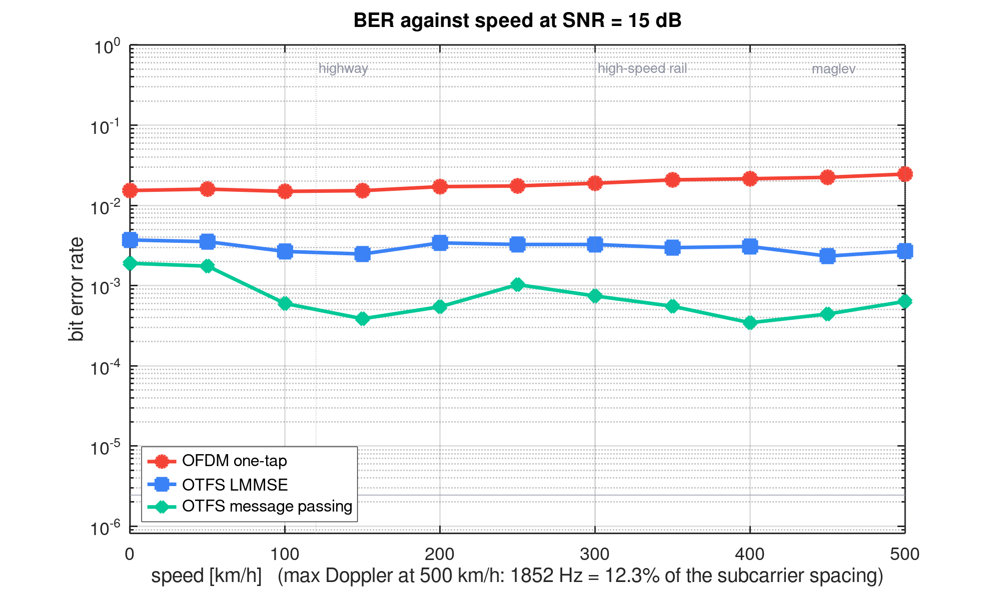
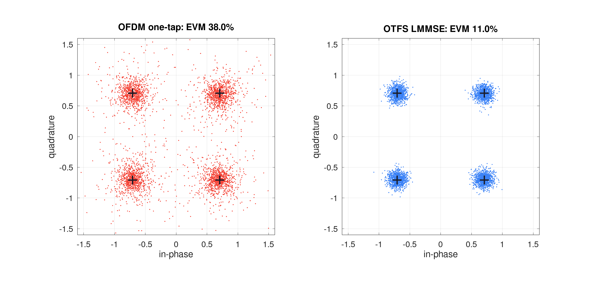

<p align="center"></p>

<p align="center">


</p>

<h3 align="center">OFDM sees a channel that changes every microsecond.<br>OTFS sees six fixed dots. That is the whole idea, and this repository measures what it is worth.</h3>

Every phone today speaks **OFDM**: the data sits on a grid of time slots and subcarrier frequencies. OFDM works because each subcarrier sees a flat, unchanging channel during one symbol. On a high-speed train that stops being true. The Doppler shift smears each subcarrier into its neighbours (inter-carrier interference), and the channel changes from one symbol to the next.

**OTFS** (orthogonal time frequency space) puts the data on a different grid: **delay × Doppler**. In that domain a channel with six reflectors is just six dots, one per path, at a fixed delay and Doppler shift. The dots barely move during a frame, even at 500 km/h. Every symbol is spread over the whole time-frequency frame and sees all six paths, so a good detector collects the energy of all of them.

This repository builds both systems from scratch in plain MATLAB (modulator, channel, three receivers) and compares them from 0 to 500 km/h.

<table>
<tr>
<td align="center" width="25%"><h2>59×</h2><sub>lower BER with OTFS message passing<br>at 500 km/h, 15 dB<br>(3.96·10⁻⁴ vs 2.35·10⁻²)</sub></td>
<td align="center" width="25%"><h2>11.0 %</h2><sub>EVM of OTFS at 500 km/h, 30 dB<br>(OFDM: <b>38.0 %</b>)</sub></td>
<td align="center" width="25%"><h2>flat</h2><sub>OTFS BER from 0 to 500 km/h;<br>OFDM gets 60 % worse</sub></td>
<td align="center" width="25%"><h2>1.5 %</h2><sub>cyclic-prefix overhead of OTFS<br>(OFDM: 20 %)</sub></td>
</tr>
</table>

<p align="center"></p>
<p align="center"><sub>The same six paths, speed sweeping 0 → 500 → 0 km/h. Left: the time-frequency channel OFDM has to track, a moving landscape. Right: the same channel in delay-Doppler, six dots that slide sideways as the Doppler grows.</sub></p>

---

## ⟡ Run it

```matlab
>> main                          % MATLAB R2016b or newer, no toolboxes
```
```bash
octave --no-gui --eval main      # GNU Octave 6 or newer
```

`main` writes four figures to [`figures/`](figures), the BER tables to [`results/`](results) as CSV, and [`results/summary.txt`](results/summary.txt). The full run simulated 600 frames per SNR point and 400 frames per speed, and took 35 minutes in Octave on one laptop core (MATLAB is usually several times faster on the matrix inversions). All figures and numbers on this page come from that run of this exact code in **GNU Octave 10.3**. The build machine has no MATLAB licence, so the code uses only base functions that behave the same in both.



## ⟡ The system

| Parameter | Value |
|:--|:--|
| Carrier, subcarrier spacing | 4 GHz, 15 kHz (5G NR numerology 0) |
| Frame | M = 32 subcarriers (delay bins) × N = 16 symbols (Doppler bins) = 512 QPSK symbols |
| Sample rate | 480 kHz, one delay bin = 2.08 µs |
| Channel | 6 paths, delays 0 – 5 samples, exponential profile 0 to −7.5 dB, Rayleigh gains |
| Doppler | Jakes: $\nu_i = \nu_{\max}\cos\theta_i$, $\theta_i$ uniform; $\nu_{\max} = 1852$ Hz at 500 km/h |
| Cyclic prefix | 8 samples: per symbol for OFDM (8/40 = 20 %), once per frame for OTFS (8/520 = 1.5 %) |
| Channel knowledge | perfect at the receiver (both systems), so only the waveform and detector differ |

At 500 km/h the maximum Doppler is 12.3 % of the subcarrier spacing, or 1.98 Doppler bins of the OTFS frame: the dots land between bins (fractional Doppler) and leak a little into their neighbours, which the simulation keeps.

### The OTFS transform pair

The transmitter maps the delay-Doppler symbols $x[l,k]$ to time-frequency with the inverse symplectic finite Fourier transform, then sends them like OFDM (Heisenberg transform):

$$X[n,m] = \frac{1}{\sqrt{NM}}\sum_{k=0}^{N-1}\sum_{l=0}^{M-1} x[l,k]\, e^{\,j2\pi\left(\frac{nk}{N}-\frac{ml}{M}\right)}$$

With rectangular pulses this collapses to an IFFT along the Doppler axis of each delay row. The channel acts on the received delay-Doppler grid as a sparse matrix:

$$\mathbf{y} = \mathbf{H}_{\text{DD}}\,\mathbf{x} + \mathbf{w},\qquad \mathbf{H}_{\text{DD}} = \mathbf{A}\Big(\sum_{i=1}^{6} h_i\,\boldsymbol{\Delta}^{\nu_i}\,\boldsymbol{\Pi}^{\ell_i}\Big)\mathbf{A}^{H}$$

where $\boldsymbol{\Pi}$ is a cyclic delay by one sample, $\boldsymbol{\Delta}$ a diagonal Doppler phase ramp, and $\mathbf{A}$ the OTFS demodulator. Every row of $\mathbf{H}_{\text{DD}}$ has only a handful of significant entries, which is what makes message passing cheap.

### The three receivers

* **OFDM, one-tap MMSE.** Divide each subcarrier by the channel at the middle of the symbol. It is the receiver every LTE and 5G phone uses. It cannot undo inter-carrier interference.
* **OTFS, block LMMSE.** $\hat{\mathbf{x}} = (\mathbf{H}^H\mathbf{H}+\sigma^2\mathbf{I})^{-1}\mathbf{H}^H\mathbf{y}$ on the full 512 × 512 matrix. Linear, optimal among linear detectors, $O((MN)^3)$.
* **OTFS, message passing** (Raviteja, Phan, Hong and Viterbo, 2018). Each observation treats the interference on a symbol as Gaussian with mean and variance from the other symbols' current beliefs, each symbol combines the evidence of every observation it touches, 20 damped iterations. Complexity grows linearly with the frame.

## ⟡ Results

### 1. Two views of one channel

<p align="center"></p>

The same channel at 500 km/h. Left: what OFDM has to equalize, 512 different complex gains that change in both time and frequency. Right: what OTFS sees, six tall bars (one per path) and a little leakage around them from the fractional Doppler.

### 2. BER against SNR at 500 km/h

<p align="center"></p>

| SNR | OFDM one-tap | OTFS LMMSE | OTFS message passing |
|--:|--:|--:|--:|
| 0 dB | 0.216 | 0.205 | 0.204 |
| 6 dB | 0.0978 | 0.0789 | 0.0671 |
| 12 dB | 0.0390 | 0.0137 | 0.00388 |
| 15 dB | 0.0235 | 0.00245 | **0.000396** |
| 18 dB | 0.0177 | 0.000368 | **0.0000765** |
| 21 dB | 0.0131 | 0.0000358 | **0.0000228** |

*Uncoded QPSK, 6.1 × 10⁵ bits per point.*

OFDM's curve flattens: above 15 dB its errors come from inter-carrier interference, not noise, so more power barely helps. Both OTFS detectors keep falling. Message passing is the best at every SNR up to 18 dB. At 21 dB LMMSE nearly catches up, because with little noise the linear detector inverts the channel almost perfectly.

### 3. BER against speed

<p align="center"></p>

At 15 dB, from standstill to maglev speed: OFDM degrades from 1.53·10⁻² to 2.45·10⁻² (+60 %) as the Doppler grows. OTFS with LMMSE stays between 2.3 and 3.7·10⁻³, and with message passing between 3.4·10⁻⁴ and 1.9·10⁻³ for every speed, with no upward trend.

**Read this figure honestly:** most of the gap is already there at 0 km/h. A stationary channel is still frequency-selective, and uncoded OFDM loses every bit on a subcarrier that sits in a fade. OTFS spreads every symbol over all subcarriers and all time slots, so it collects the frequency diversity of all six paths. In a real OFDM link a channel code does a similar job across subcarriers. The part of the gap that comes from mobility is OFDM's +60 % rise from 0 to 500 km/h, which OTFS does not show. Message passing is less consistent at low speed (1.9·10⁻³ at 0 km/h) because without Doppler the paths of one delay share a Doppler bin and its Gaussian interference model is less accurate.

### 4. Constellations

<p align="center"></p>

At 500 km/h and 30 dB, where noise is negligible: the OFDM clusters trail long tails of scattered points (EVM 38.0 %): those are the subcarriers hit hardest by inter-carrier interference. The OTFS LMMSE points form four tight clusters (EVM 11.0 %).

## ⟡ Fair-comparison notes

* **Same channel, same SNR, same receiver knowledge.** Both systems see identical channel realizations, and both receivers know the channel perfectly. Channel estimation is a separate (and real) problem: OTFS usually uses an embedded pilot with guard bins in delay-Doppler.
* **SNR is per received sample.** The energy and time OFDM spends on 16 cyclic prefixes (20 % overhead, against 1.5 % for OTFS) is not charged to it, so the comparison is, if anything, kind to OFDM.
* **Uncoded.** No channel coding on either side. With strong coding the gap closes at low speed (coding recovers frequency diversity for OFDM); at high speed OFDM keeps its interference floor.
* **Complexity.** The one-tap OFDM receiver costs a division per subcarrier. LMMSE inverts a 512 × 512 matrix per frame; message passing is far cheaper but iterative. This is the price of OTFS.

## ⟡ Repository map

```
otfs-vs-ofdm-high-mobility-matlab/
├── main.m                  runs everything, writes results/summary.txt
├── src/
│   ├── otfs_params.m       numerology and channel profile
│   ├── draw_channel.m      6 Rayleigh paths with Jakes Doppler
│   ├── apply_channel.m     time-varying multipath on the sample stream
│   ├── otfs_mod.m / otfs_demod.m      ISFFT + Heisenberg, Wigner + SFFT
│   ├── otfs_channel_matrix.m          the delay-Doppler matrix H_DD
│   ├── mp_detector.m       message-passing detector (Raviteja et al. 2018)
│   ├── ofdm_link.m         OFDM with per-symbol CP and one-tap MMSE
│   ├── otfs_link.m         OTFS with LMMSE and message passing
│   ├── tf_response.m       time-frequency channel for the figures
│   └── qpsk.m, qpsk_bits.m, neon.m, save_figure.m, write_csv.m
├── experiments/
│   ├── exp1_two_views.m    TF vs DD view of one channel
│   ├── exp2_ber_vs_snr.m   BER vs SNR at 500 km/h
│   ├── exp3_ber_vs_speed.m BER vs speed at 15 dB
│   ├── exp4_constellations.m
│   ├── ber_point.m         one Monte Carlo point for all three receivers
│   └── make_frames.m       frames of the animation
├── figures/  results/  assets/
```

## ⟡ References

1. R. Hadani et al., "Orthogonal time frequency space modulation," *IEEE WCNC*, 2017.
2. P. Raviteja, K. T. Phan, Y. Hong and E. Viterbo, "Interference cancellation and iterative detection for orthogonal time frequency space modulation," *IEEE Trans. Wireless Commun.*, vol. 17, no. 10, pp. 6501–6515, 2018.
3. Z. Wei et al., "Orthogonal time-frequency space modulation: A promising next-generation waveform," *IEEE Wireless Commun.*, vol. 28, no. 4, pp. 136–144, 2021.
4. Y. Hong, T. Thaj and E. Viterbo, *Delay-Doppler Communications: Principles and Applications*, Academic Press, 2022.
5. W. C. Jakes, *Microwave Mobile Communications*, Wiley, 1974.

## ⟡ Cite

```bibtex
@software{salim_otfs_2026,
  author = {Salim, Jaafar},
  title  = {OTFS versus OFDM at High Mobility: a MATLAB Study},
  year   = {2026},
  url    = {https://github.com/jafarSalim/otfs-vs-ofdm-high-mobility-matlab}
}
```

<p align="center"><sub>MIT licence · Eng. Jaafar Salim · MATLAB-compatible code, figures rendered in GNU Octave 10.3</sub></p>
